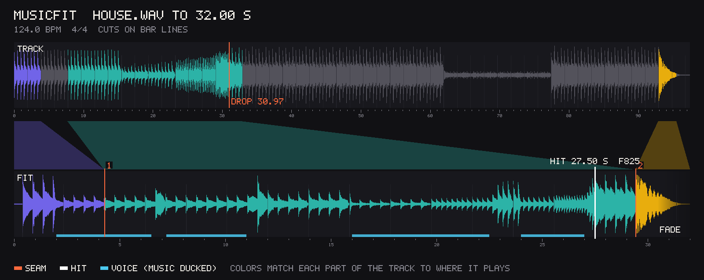

# musicfit

Fit a music track to a video cut. musicfit makes the track exactly as long as the video by cutting or looping whole bars, lands its drop on the second you pick, ends it on a beat, ducks it under a voice and sets its loudness. Give it the video too and it lays the track under it.

```bash
npx musicfit@latest track.mp3 --length 32 --hit 27.5 --fps 30
```



AI music models ignore the length you ask for. Ask for 30 seconds and you may get 47, or two minutes, and the drop the edit was built around comes whenever it comes. So the track gets cut at the video's last frame and stops in the middle of a bar, or it fades out on no beat in particular, and the big hit lands a second after the logo. Fixing that by hand means finding the bar lines in a waveform, cutting on them, nudging crossfades and doing the arithmetic for where the drop has to go. musicfit does it the way a music editor would: it finds the beats and the bar lines, cuts or loops whole bars where they sound alike, keeps the start and the ending of the track, and tells you which seconds to listen to.

The track can come from any music model, and [Wiro](https://wiro.ai/explore/music-generation) has several.

## What you get

```
musicfit-track/
  fitted.wav     the track, exactly --length long, 48 kHz stereo, at -14 LUFS
  mix.wav        with --voice: the voice over the ducked music
  video.mp4      with --video: the video with the track under it, its picture as it was
  cues.json      every beat and bar, the hit, the seams and the fade, in seconds and frames
  seams.png      the track, the result and what went where, like the picture above
  FIT.md         what was done and where to listen, for people and agents
```

- Cuts and loops are made only on bar lines, in whole bars, between bars that sound alike, and keep the track's four-bar phrases whole where they can. Each seam is a 30 ms crossfade that ends just before the downbeat, so the new bar's first hit plays whole, and the hits on either side are lined up to the millisecond.
- The drop lands on `--hit` to the sample, on the start of its attack. Nothing that comes after the drop in the track plays before it, so it is heard first where you asked.
- The track starts the way it starts, with its own pickup, and ends on its own last hit when it has one and there is room. Otherwise it ends with a fade that starts on a beat and ends on one. A fit too short for the track's opening and its ending both can start later in the track, on a bar, so without `--hit` it can be the track's last bars alone; FIT.md says where it starts.
- `--voice` lowers the music 10 dB (`--duck`) wherever the voice speaks, starting 0.15 s before each phrase and coming back 0.5 s after.
- `--video` lays the result under the video: see [Laying it under a video](#laying-it-under-a-video).
- Loudness is measured with ffmpeg's EBU R128 meter and set with one gain; a true-peak limiter holds the peaks under -1 dBTP only when that gain would push them over.
- `cues.json` lists `beats`, `bars` and `hits` (the drop and the track's own last hit) as frame numbers at `--fps`, ready for a Remotion `<Sequence from={cues.bars[8]}>`, and the same moments in seconds under `times`. The seams, sections, fade and loudness are in it too:

```json
{
  "fps": 30,
  "frames": 960,
  "bpm": 124,
  "beats": [12, 26, 41, 55, 70, 84],
  "bars": [12, 70, 128, 186],
  "hits": [825, 883],
  "times": { "beats": [0.394, 0.878, 1.362], "hits": [27.5, 29.427] },
  "drop": { "time": 27.5, "frame": 825, "source": 30.972, "sourceBar": 17 },
  "seams": [{ "time": 4.265, "frame": 128, "kind": "cut", "bars": 2, "likeness": 0.91 }]
}
```

The lists are cut short here; the file has every beat and bar.

`--analyze` reads a track without fitting it and saves its `cues.json`, `seams.png` and `FIT.md` in `musicfit-track.analysis/` by default. No fit's folder can have that name, so reading a track never replaces a fit, unless both are given the same `--out`: an analysis that ends well in a fit's folder replaces that fit, its `fitted.wav`, `mix.wav` and `video.mp4` too, and says so.

## Laying it under a video

Give `--video` the video the track is for, and musicfit also writes `video.mp4`: that video's picture, copied as it is and never encoded again, with the fitted track under it at the loudness target. The video has to be `--length` long to a frame, counted from its first frame, and without `--fps` the frames count at its own frame rate.

`--video-sound` says what becomes of the video's own sound:

- `keep`, for sound effects. Each place where it plays is set 3 dB louder than the music there, and no quieter than the loudness target, so a place over quiet music or none plays at the target. It goes no louder than keeps its true peaks, with the music's, under -1 dBTP, so the limiter takes nothing off the music. Where that leaves a place short of 3 dB over the music, as a sharp sound or one on a loud drop can be, the music dips under that place alone by what is missing, `--duck` (10 dB) at most. A note names a place that stays short even so.
- `voice`, for speech. It is set to the loudness target where it speaks, and the music dips `--duck` (10 dB) under it, in `fitted.wav` and `mix.wav` too, as under `--voice`.
- `drop`, for music of its own. It is left out.

With `keep` the music plays as in `fitted.wav` away from the places it dips under, and as it dips, `video.mp4` can come out under the target, a little at the default and more at a loud `--lufs`; a note says so when it is more than half a LU short. In a 29 s launch film whose own sound is five sound effects, measured in `video.mp4`, the logo sound on the drop came out 3.4 dB over the music with the music 7.7 dB down under it, another sound 2.9 dB over with the music 5.9 dB down, and the other three 2.5 to 2.9 dB over with the music 1.1 dB down under one of them; the film came out at -14.4 LUFS, and at -12.1 LUFS with `--lufs -11`.

With `--voice` as well, the music dips under the voice as it always does and each place is set over that music, so a place the voice speaks over plays at the loudness target, as loud as the voice, and the music needs no further dip there. The voice's peaks hold no place back: where a place meets the voice a limiter holds the two under -1 dBTP, and takes a little off both for those moments, so `video.mp4` reaches the target. With a voice over that same film, the two sounds it speaks over all the way through came out 10.8 and 8.6 dB over the music as it dips, and the film at -14 LUFS.

musicfit cannot tell speech from sound effects or from music, so a video with more than a faint room tone of its own is refused until you choose. Of several sound streams it reads only the first, and a note says how many the video has; when the first is silent or nearly so and a later one is not, the run is refused, as that sound would be left out: give a copy with that sound first, or `--video-sound drop` to go on without it. A voice the video already holds goes with `--video-sound voice`, not as a copy given to `--voice`, which would lay it in twice; when the video itself is the track or the `--voice` file, its sound is laid in once. `--help` says how loud each part is set, and FIT.md how `video.mp4` came out after the AAC encoding. `video.mp4` carries a comment that says musicfit made it, and names no file.

A video is refused before any work when it:

- cannot be read, or is cut short or damaged
- has no picture, or only a still one
- holds a picture an MP4 cannot take without encoding it again (ProRes, DNxHD, VP8): give an H.264 or HEVC copy
- is not `--length` long, and the message gives the length to use
- is a `video.mp4` musicfit made, unless `--video-sound drop` leaves out its sound and the fitted track in it

## What a failed run leaves

A run makes its files in a hidden `.musicfit-part-` folder, inside the out folder, or next to it when the out folder is not there yet, and puts them in place only once it has ended well. A run that fails, is refused or is stopped with Ctrl-C, Ctrl-\ or a signal (SIGTERM, SIGHUP, SIGUSR2, SIGALRM or SIGXCPU) leaves the out folder as it was: the earlier run's files stay and nothing is added. As the earlier files stay until the new ones are in place, a run needs room on the disk for both.

A run that ends well replaces the earlier run's files and removes those it does not make again, such as the `mix.wav` of a fit with a voice, and a note says which it removed. Two runs that end at the same moment in one folder take turns.

The earlier run's files are the ones its `cues.json` lists, while they are as it wrote them: `cues.json` records the size and the SHA-256 of each file it lists, and its own SHA-256, so a file changed since, `cues.json` included, is no longer the earlier run's. A folder musicfit 0.1 wrote has no such record; there a file its `cues.json` lists counts as musicfit's while it looks as 0.1 left it (`fitted.wav` and `mix.wav` as long as the fit, `seams.png` and `FIT.md` as musicfit makes them) and was not changed more than a minute before or after `cues.json`.

Any other file under one of musicfit's names (`fitted.wav`, `mix.wav`, `video.mp4`, `cues.json`, `seams.png`, `FIT.md`) is taken for yours: a run that would write over it is refused before any work, and one that would not leaves it alone. A run whose track, voice or video is one of the files it would replace or remove is refused before any work too.

A run killed outright (`kill -9`, or the system when memory runs out) cannot tidy up, and its hidden folder stays. A later run that ends well in the same place removes it once the killed run is gone and nothing in it has changed for 15 minutes; one it may not look into stays, and does not fail that run. A run killed in the moment it moved its files in also leaves some of its new files in the out folder, the earlier ones in its hidden folder and a `.musicfit-commit` file: the next run in that folder puts the earlier files back before anything else, and no other run removes that hidden folder. A failed or stopped run that cannot remove its own hidden folder names it in its message, and that folder goes the same way.

When another program holds a file open so that it cannot be moved, the run says so, takes its new files out again and puts the earlier ones back. An earlier file it cannot put back waits in the folder the message names, with a note of where each file belongs; no later run removes that folder.

## Use it with your agent

musicfit ships as an [Agent Skill](https://agentskills.io). Install it once and your agent runs it by itself when a video needs music that fits:

```bash
npx skills add EminBudak/musicfit
```

That covers Claude Code, Codex, Cursor and the other agents the [`skills`](https://github.com/vercel-labs/skills) CLI supports. In Claude Code you can add it as a plugin instead:

```
/plugin marketplace add EminBudak/musicfit
/plugin install musicfit@musicfit
```

In GitHub Copilot CLI it takes the same two steps:

```bash
copilot plugin marketplace add EminBudak/musicfit
copilot plugin install musicfit@musicfit
```

Then ask as usual:

> Fit track.mp3 to my 30 second launch video, with the drop on the logo at 24 seconds

The skill carries its own script, so it installs nothing else and needs no API key.

## Use it from the command line

```
npx musicfit@latest <track> --length <time> [options]

  --length <time>   how long the result is, e.g. 32, 32s, 960f or 1:05
  --hit <time>      where the drop lands in the result
  --drop <time>     where the drop is in the track (default: found)
  --fps <n>         frame rate for frame numbers, e.g. 30, 25, 29.97
                    (default: the video's with --video, else 30)
  --voice <file>    a voice track on the video's timeline; the music dips under it
  --duck <dB>       how far the music dips under the voice (default: 10), and
                    the most it dips under the video's own sound with keep
  --video <file>    a video to lay the result under: also writes video.mp4,
                    the video's picture as it was with this sound under it.
                    The video has to be --length long, to a frame
  --video-sound <how>
                    what becomes of the video's own sound: keep (sound
                    effects: each place it plays set 3 dB louder than the
                    music there, between --lufs and 6 dB over it, and no
                    louder than keeps its true peaks, with the music's,
                    under -1 dBTP; where that leaves it less than 3 dB over
                    the music, the music dips under that place alone by as
                    much, --duck at most. With --voice the places are set
                    over the music as it dips under the voice, and where
                    one meets the voice a limiter holds the two under
                    -1 dBTP), voice (speech: set to --lufs where it plays,
                    and the music dips --duck under it) or drop (music of
                    its own: left out). A faint room tone, or a voice with
                    no speech found, is only turned down to --lufs if it is
                    louder. Without it, a video with more than a faint room
                    tone of its own is refused until you choose
  --lufs <n>        loudness target in LUFS (default: -14)
  --end <kind>      auto, natural (the track's own ending) or fade (default: auto)
  --fade <s>        length of the closing fade, in whole beats (default: a bar)
  --bpm <n>         the tempo, when the one found is half or double the real one
  --meter <n>       beats to a bar, 3 or 4 (default: found)
  --out <dir>       where to save (default: ./musicfit-<track name>, or
                    ./musicfit-<track name>.analysis with --analyze)
  --analyze         only read the track: its beats, bars, drop and ending
  --json            print cues.json instead of a summary
```

Times are seconds unless they end in `f`, which counts frames at `--fps`, or with `--video` and no `--fps` at the video's frame rate. The track can be any file ffmpeg reads, the sound of a video included. musicfit reads files, not addresses: a track, a voice or a video given as `https://...` is refused, so download it first.

Some runs:

```bash
npx musicfit@latest track.mp3 --length 15
npx musicfit@latest track.mp3 --length 900f --hit 450f --fps 30 --out public/music
npx musicfit@latest track.mp3 --length 1:30 --hit 41 --voice vo.wav --lufs -16
npx musicfit@latest track.mp3 --length 733f --hit 600f --video film.mp4 --video-sound keep
npx musicfit@latest track.mp3 --length 32 --video talk.mp4 --video-sound voice
npx musicfit@latest track.mp3 --analyze
```

Installed globally (`npm install -g musicfit`), the command is `musicfit`. npx keeps the copy an earlier run fetched, so `npx musicfit@latest` is how you get a newer version.

It needs Node 22 or newer and ffmpeg 4.4 or newer (`brew install ffmpeg`, `sudo apt install ffmpeg` or `winget install ffmpeg`); the tests run on Ubuntu 22.04's ffmpeg 4.4 and on the latest Ubuntu's, before every release too. Set `FFMPEG_PATH` to pick the ffmpeg. There are no npm dependencies; the beat tracking is plain JavaScript and nothing leaves your machine.

## How it works

1. Decodes the track with ffmpeg and measures, in 10 ms frames, how much each of 40 frequency bands rises: the onsets.
2. Finds the period the onsets repeat at, then decides which of its halves, doubles or thirds is the beat. A tempo near 115 BPM is more likely, a kick and a snare taking turns says that is the beat people clap to, and a kick between the beats says the beat is faster. When the tempo could just as well be half or double, it says so.
3. Tracks the beats with dynamic programming (Ellis's method, as in librosa), moves each onto its onset, and fits them to one steady line when the tempo holds.
4. Finds the bar lines from where the kicks, the chord changes and the changes in loudness fall, and whether a bar has three beats or four.
5. Describes every bar by its harmony, timbre, loudness and rhythm, finds where sections change, the drop (the first time the track reaches its fullest after a quieter stretch, on a phrase line) and how the track ends.
6. Lays the result out as slots one bar long, lined up so a slot starts exactly on the hit, and fills them with bars of the track by dynamic programming: playing on costs nothing, a seam costs more the less its two sides sound like bars that follow each other in the track, and more again when it breaks a four-bar phrase or leaves a build before its drop.
7. Joins the bars with short crossfades, lines up the hits at every seam, fades the head and the tail, ducks the voice, sets the loudness, and writes the files. With `--video` it reads the video's packets first, to know its length and frame rate and to refuse what it cannot take, and at the end puts the new sound under its picture, which it copies as it is.

## Limits

- One hit per run. A second moment that must land on a beat can use the bar frames in `cues.json`.
- The tempo can be read as half or double the real one, the main failure of beat tracking. musicfit warns when both are likely and then cuts only in pairs of bars, which stays on the bar lines either way; `--bpm` settles it.
- When nothing in a track marks the first beat of the bar, the bar lines can come out a beat off. musicfit says when it is unsure, and the cuts still keep the beat, since they skip whole bars.
- A groove whose loudest hits fall between the beats over a sparse kick, as in some dembow and afrobeats patterns, can be read half a beat off without a warning. Listen to the first seam.
- Tracks with no steady beat (ambient, rubato piano) are joined with one-second crossfades where they sound alike, not on bar lines. Listen to every seam.
- A tempo that changes a lot within the track, or a bar of 2/4 in a 4/4 song, can put a seam a beat off.
- Seams follow bars and sound, not words: in a song with singing a cut can fall in the middle of a line. An instrumental fits best.
- Lengthening loops bars the track already has, so a 30 second track stretched to 3 minutes repeats, and so does the intro when the drop is asked for much later than the track has it (musicfit says how many times). Ask the music model for a little more than you need.
- `--video` copies the picture as it is, so a picture an MP4 cannot hold that way (ProRes, DNxHD, VP8) is refused rather than encoded again. Only the picture and the new sound go into `video.mp4`: subtitles and other streams of the video are left out, and of several sound streams only the first is read.
- A fit holds its sound in memory a few times over, so memory grows with `--length` and with the length of the track itself: a 10 minute fit of a 10 minute track took 0.9 to 1 GB, 1.2 GB with `--video` and its own sound kept, 1.4 to 1.5 GB with `--voice` and 1.7 GB with a voice and the video's own sound as well, on a desktop with ffmpeg 8 and in a 2 GB container with ffmpeg 4.4. A run takes a few seconds, and with `--video` of a long film a minute or more, most of it spent encoding the sound as AAC.
- musicfit cannot tell speech from sound effects or from music, which is why it asks for `--video-sound`. With `voice` the music dips under anything in that sound that stands out, a cough or a door as much as a word, and a hiss or a hum under a quiet voice comes up with it. With `keep` each place is set on its own, so a soft effect and a loud one over the same music come out alike, and a hiss or a hum between them comes up with the places around it.
- It does not change the tempo or the pitch, and it does not check whether you may use the track.

## See also

- [launch-film](https://github.com/EminBudak/launch-film) turns a site into a short launch film, rendered on your machine.
- [easyscreenshotkit](https://github.com/EminBudak/easyscreenshotkit) saves clean screenshots of a website's pages.
- [easybrandkit](https://github.com/EminBudak/easybrandkit) saves a site's real logo files, colors and fonts as a brand kit.

## License

MIT
